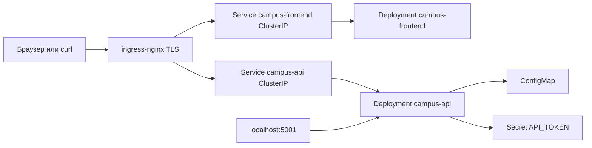

# КТ2. Контейнеризация и Kubernetes

CampusBoard: статический frontend и HTTP API объявлений. Стенд локальный. Managed-аккаунта Yandex Cloud в этой среде нет, платных ресурсов нет. Кластер — `kind` с именем `campus`, реестр — локальный OCI `127.0.0.1:5001`, вход — TLS на https://campus-dev.local:8443 и https://campus-stage.local:8443. Сертификат самоподписанный, в Git не хранится.

Журнал T01–T12 лежит в `evidence/`. Его пишет `ci/release.ps1`.

## Архитектура



Путь запроса: клиент попадает на Ingress-контроллер `nginx` (`ingressClassName: nginx`). Путь `/` идёт в Service frontend, путь `/api` — в Service API. Оба Service имеют тип ClusterIP. Прямого NodePort у приложения нет.

База в стенд не входит. `DATABASE_URL` не задан, API сообщает `"database": "not-configured"`. Deployment с PostgreSQL или MySQL в кластере нет, публичного адреса БД нет. Исходящий трафик namespace закрыт, порт 5432 не открыт. Когда появится managed-база в частной сети, для неё добавляется одно egress-правило с Pod API на её адрес.

## Образ

`app/Dockerfile` — две стадии от `python:3.13-slim`, база закреплена digest:

`sha256:09a17cad02668ae61ece136b4fd36ac3849e14f670ebedb637ea3e15580525bc`

Стадия build собирает wheels из `requirements.txt` и компилирует `app.py`. Сторонних пакетов нет, файл зависимостей оставлен, чтобы следующую библиотеку можно было добавить без смены Dockerfile. Стадия запуска создаёт UID/GID 10001 и завершается `USER 10001` и `ENTRYPOINT ["python", "/app/app.py"]`. Версия и флаг readiness приходят build-arg и остаются в ENV образа: смена сообщения, уровня логов и токена rebuild не требует, их приносят ConfigMap и Secret. Секрета в ARG, ENV и истории слоёв нет.

Тег релиза — полный SHA коммита, из которого собран образ. `latest` не используется. В Deployment попадает digest реестра, его записывает `ci/release.ps1` в overlays. Рядом собираются `2.0.0` и `bad` только для испытаний обновления и отката.

`.dockerignore` не пускает в контекст `.git`, `.env`, ключи, сертификаты и тесты.

## Манифесты

Общие объекты в `k8s/base`. `k8s/overlays/dev` и `k8s/overlays/stage` отличаются namespace, host, текстом ConfigMap и уровнем логов, а не копией Deployment.

| Объект | Зачем |
| --- | --- |
| Namespace `campus-dev` / `campus-stage` | общая метка `app.kubernetes.io/part-of=campusboard` и метка среды |
| Deployment `campus-api` | 2 реплики, RollingUpdate `maxUnavailable: 0`, `maxSurge: 1`, `progressDeadlineSeconds: 80`, `revisionHistoryLimit: 3` |
| Deployment `campus-frontend` | `nginxinc/nginx-unprivileged` по digest |
| Service | ClusterIP, `targetPort` имени `http` (8080) |
| Ingress | контроллер nginx, TLS, `/api` на API и `/` на frontend |
| ConfigMap | `MESSAGE` и `LOG_LEVEL`, страница и конфиг nginx |
| Secret `campus-api-secret` | создаётся командой `kubectl create secret`, значения в Git нет |
| NetworkPolicy | default deny ingress и egress, DNS и вход только от ingress |
| ServiceAccount | отдельные учётки API и frontend, токен в Pod не монтируется, Role нет |
| PDB | `minAvailable: 1` у API и frontend |
| HPA | CPU 70%, минимум 2, максимум 4 |

`maxUnavailable: 0` не даёт погасить старый Pod, пока новый не стал Ready. Плохая версия не попадает в endpoints, запросы остаются на предыдущей. `maxSurge: 1` разрешает один лишний Pod на время замены. PDB держит минимум одну реплику при добровольном drain и не спасает от падения единственного узла, от `delete` всех Pod и от провала readiness.

Probes: startup на `/live`, readiness на `/ready` (способность ответить объявлениями, а не пустой ping), liveness на `/live`. У контейнеров есть requests и limits. `terminationGracePeriodSeconds: 15`. Процесс API на SIGTERM перестаёт принимать новые соединения и дописывает уже начатые ответы. Корень файловой системы только для чтения, `/tmp` — это emptyDir.

Кластер из одного узла. Pod не распределяются по машинам, отказ узла гасит весь стенд.

## Безопасность

`runAsNonRoot`, UID/GID 10001 у API и 101 у nginx, `allowPrivilegeEscalation: false`, `capabilities.drop: ALL`, `seccompProfile: RuntimeDefault`, `readOnlyRootFilesystem`. NetworkPolicy проверяется двумя запросами: Pod из `ingress-nginx` доходит до ClusterIP, Pod из того же namespace — нет. `kubectl auth can-i` от ServiceAccount API не может читать секреты и создавать Deployment.

Скан образа выполняется до push. Находки в базовом Debian принимаются явно: приложение не ставит своих пакетов, digest базы записан, `latest` не публикуется. base64 Secret шифрованием не считается.

## Конвейер

`ci/cluster.ps1` поднимает registry, kind, Calico, ingress-nginx и metrics-server. Calico нужен, потому что штатный CNI kind не применяет NetworkPolicy.

`ci/release.ps1` выполняет ворота по порядку: unit-тесты, сборка с тегом commit SHA, скан, push, запись digest, `kubectl diff`, apply dev, ожидание rollout, smoke, apply stage. Откат обязателен, если новые Pod не становятся Ready дольше `progressDeadlineSeconds` или HTTP через Ingress дважды подряд не отвечает 200.

Файл `.github/workflows/release.yml` повторяет тесты, сборку по `GITHUB_SHA` и рендер overlays. Прогон, по которому заполнен `evidence/`, выполнен локальным скриптом.

## Как повторить

Нужны Docker Desktop, kubectl и kind.

```powershell
powershell -ExecutionPolicy Bypass -File .\ci\cluster.ps1
powershell -ExecutionPolicy Bypass -File .\ci\release.ps1
```

Проверка: `curl.exe -k --resolve campus-dev.local:8443:127.0.0.1 https://campus-dev.local:8443/` и тот же адрес с `/api/announcements`. Stage открывается как `campus-stage.local`.

## Журнал

| ID | Файл | Что доказывает |
| --- | --- | --- |
| T01 | `evidence/T01-image.txt` | тег равен commit, digest реестра записан |
| T02 | `evidence/T02-nonroot.txt` | `id` внутри Pod, UID 10001 |
| T03 | `evidence/T03-readonly.txt` | запись в корень запрещена, `/tmp` доступен |
| T04 | `evidence/T04-replicas.txt` | 2/2 Ready |
| T05 | `evidence/T05-service.txt` | EndpointSlice и ответ ClusterIP |
| T06 | `evidence/T06-tls.txt` | TLS отвечает, Service не NodePort |
| T07 | `evidence/T07-self-healing.txt` | удаление Pod возвращает реплику |
| T08 | `evidence/T08-rolling.txt` | замена на новый digest без обрыва HTTP |
| T09 | `evidence/T09-rollback.txt` | плохой readiness, deadline, undo |
| T10 | `evidence/T10-resources.txt` | requests/limits, ручной scale и HPA |
| T11 | `evidence/T11-networkpolicy.txt` | разрешённый и запрещённый путь |
| T12 | `evidence/T12-secrets-db.txt` | секрета в Git нет, БД в кластере нет |

Сводка прогона 2026-11-07: `evidence/RESULTS.txt`, все пункты T01–T12 пройдены.

Образ релиза: `localhost:5001/campus-api@sha256:bd0fb07602e37ae697813b5b5bded72cfc73db5485347e622186339599f26c8b`. Идентификатор образа — этот digest. Плохой образ для отката: `sha256:9fe77c3f95a118d6e830e5692adcd3bc4506ea004a89dd31a0cebd6d50531d57`. Выкладка плохой версии началась в 12:00:30, `progressDeadlineSeconds` остановил её в 12:01:51, `rollout undo` в ту же секунду вернул 2.0.0: старые Pod не уходили из Service, потому что новая версия не стала Ready.

## Что будет, если удалить один Pod

Deployment держит желаемое число реплик. Удаление Pod меняет фактическое состояние и не меняет манифест. ReplicaSet создаёт замену. Это видно в `evidence/T07-self-healing.txt`.

## Чем docker run отличается от podman run

`docker run` — запрос к постоянному демону dockerd. Демон принимает команду через сокет и запускает контейнер через containerd и runc. Если демон останавливается, управление всеми контейнерами пропадает сразу.

`podman run` демона не требует. Команда сама порождает контейнер, а за stdout и код выхода следит отдельный процесс conmon, по одному на контейнер. Уже запущенные контейнеры продолжают работать после закрытия команды. Rootless у Podman — обычный режим. У классического Docker rootless включается отдельно. Podman в этой системе не установлен, поэтому отдельного вывода `podman history` нет.

## Затраты и очистка

Платных ресурсов нет, оценка затрат — 0. После защиты:

```powershell
kind delete cluster --name campus
docker rm -f kind-registry
```

## Что изменить в production

1. Managed Kubernetes минимум на двух узлах и сертификат от нормального CA вместо самоподписанного.
2. Образ в закрытом Container Registry, digest в манифесте проверяет admission.
3. Managed PostgreSQL без публичного адреса и секрет из Lockbox, плюс одно egress-правило только у Pod API.
